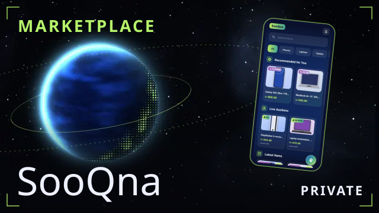
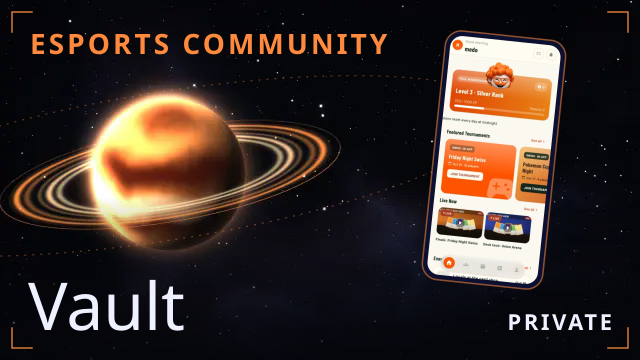
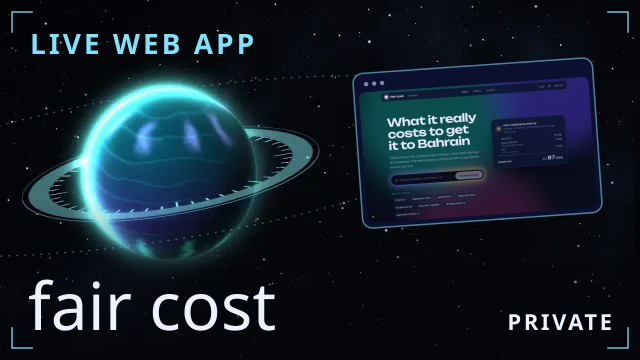
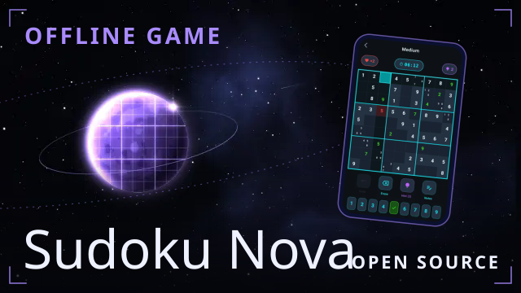
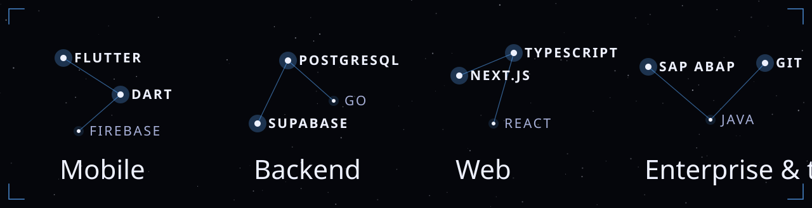

<picture>
  <source media="(prefers-color-scheme: dark)" srcset="assets/banner-dark.svg">
  <source media="(prefers-color-scheme: light)" srcset="assets/banner-light.svg">
  
</picture>

**Flutter and full-stack developer in Bahrain, with six Flutter apps and a live web app at [fair-cost.com](https://fair-cost.com). Open to full-time roles.**

I build the whole thing: Flutter on the phone, Supabase and Postgres behind it, and AI only where it has a real job, like checking a listing photo, screening a chat message or explaining a price. I'm a final-year Computer Science student at the University of Bahrain, and most recently an SAP ABAP intern at Foulath.

## Projects

The planets are frames from my site's [cosmos mode](https://mahdi-haji.dev/?mode=cosmos). The screen orbiting each one is a real screenshot of the app.

<table>
<tr>
<td width="50%" valign="top">

**SooQna** 🔒 · senior project, team of three 
A smart-electronics marketplace for Bahrain: AI-checked listing photos, live auctions with auto-bid, and an escrow wallet with a two-day inspection window. English and Arabic.

`Flutter` `Supabase` `Gemini` 
[Showcase](https://github.com/mahdawemghr/sooqna-showcase) · [Case study](https://mahdi-haji.dev/sooqna.html)

</td>
<td width="50%" valign="top">

**Vault** 🔒 
An esports community app for card games: Swiss tournaments paired inside the database, per-game leaderboards, AI-screened realtime chat and a marketplace. 2,426 passing tests.

`Flutter` `Supabase` `Firebase` 
**[vaulttcgg.com](https://vaulttcgg.com)** · [Showcase](https://github.com/mahdawemghr/vault-showcase) · [Case study](https://mahdi-haji.dev/vault.html)

</td>
</tr>
<tr>
<td width="50%" valign="top">

**fair cost** 🔒 · live web app 
One search compares shops in Bahrain, stores that ship here and parcel forwarders, then adds shipping, customs and VAT to the fils. The AI writes the advice, never the numbers.

`Next.js` `Supabase` `Claude` 
**[fair-cost.com](https://fair-cost.com)** · [Showcase](https://github.com/mahdawemghr/fair-cost-showcase) · [Case study](https://mahdi-haji.dev/faircost.html)

</td>
<td width="50%" valign="top">

**Sudoku Nova** · open source 
A neon, fully offline Sudoku for Android. All ten sound effects are synthesized at runtime in pure Dart, and an AI hint explainer says why a move works.

`Flutter` `Dart` `SQLite` 
**[Source](https://github.com/mahdawemghr/sudoku-nova)** · [Case study](https://mahdi-haji.dev/sudoku.html)

</td>
</tr>
</table>

**More projects**

- [**StationX**](https://github.com/mahdawemghr/stationx-showcase) 🔒: a strength and cardio log for Android, with 1,240+ automated tests, a pure-Dart domain layer and an opt-in Health Connect readiness check.
- [**Taqweem**](https://github.com/mahdawemghr/taqweem): an Arabic, right-to-left app that turns a Hijri month into a printable calendar poster, exported as PNG or PDF. [Case study](https://mahdi-haji.dev/taqweem.html)
- [**Gym Tracker**](https://github.com/mahdawemghr/gym_tracker): the offline companion to StationX. It logs a three-day program in on-device SQLite.

## Skills

Flutter · Dart · Supabase · PostgreSQL · Firebase · Next.js · TypeScript · React · Go · Java · SAP ABAP · Git

## Experience

- **SAP ABAP intern**, Business Systems, Foulath · Sep to Nov 2026
- **B.Sc. Computer Science**, University of Bahrain · final year
- **Currently building:** Vault, an esports community app

## Contact

  

mahdemghr2003@gmail.com · [mahdi-haji.dev](https://mahdi-haji.dev)
